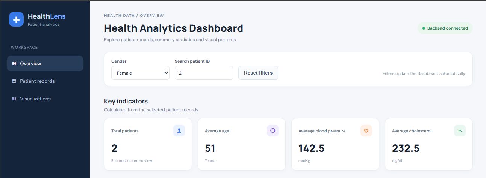
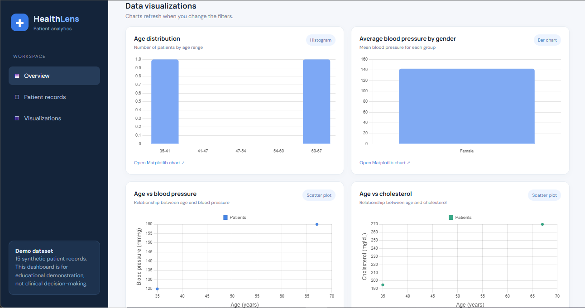
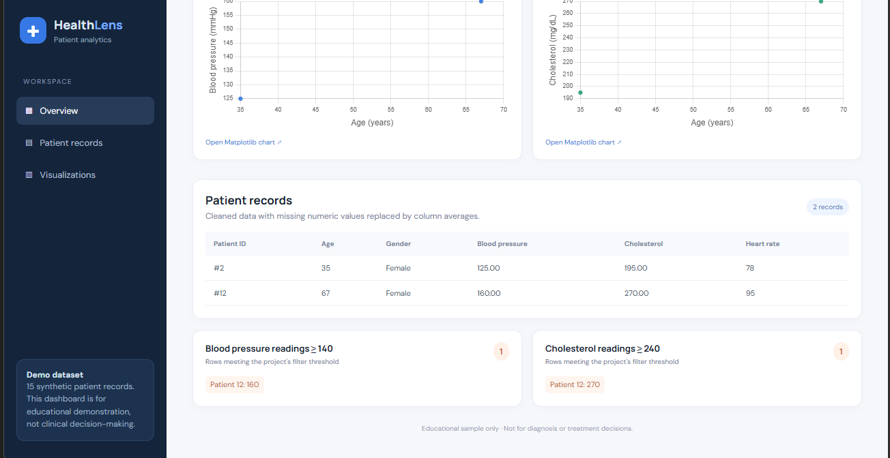

HEALTH DATA ANALYSIS AND VISUALIZATION - WEB DASHBOARD

Project structure:
health_analytics_dashboard/
  app.py
  requirements.txt
  templates/
    index.html
  static/
    style.css
    script.js

RUN IN VS CODE (Windows PowerShell):
1. Open this folder in VS Code.
2. (Recommended) Select your Python 3.14 interpreter.
3. Open the VS Code terminal in this folder.
4. Install dependencies:
      py -3.14 -m pip install -r requirements.txt
5. Start the Flask backend:
      py -3.14 app.py
6. Open this address in your browser:
      http://127.0.0.1:5000

HOW IT WORKS:
- Flask serves the HTML page and provides JSON API endpoints.
- NumPy and Pandas clean and analyze the synthetic patient dataset.
- JavaScript fetches data from Flask and updates the dashboard.
- Chart.js displays interactive browser charts.
- Matplotlib creates PNG versions of the charts through the download links.

IMPORTANT:
The patient records are synthetic and are only for educational demonstration.
The displayed thresholds are project filters, not medical diagnoses.
The dashboard uses the sample data in app.py. To use another dataset, replace
the DATA dictionary with your own appropriately structured data.

## Project Screenshots

### 1. Dashboard Overview

### 2. Data Visualizations

### 3. Patient Records
